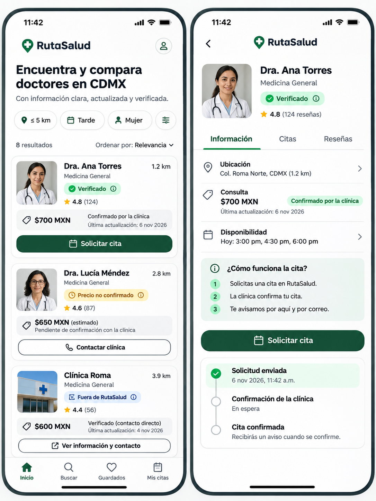
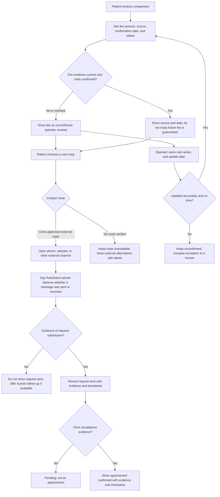
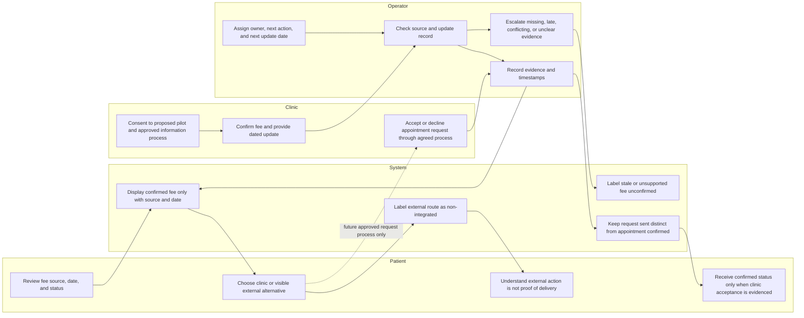

# RutaSalud — Week 13 Business Bending Packet

**Venture:** RutaSalud, a Mexico City patient-led doctor comparison platform
**Project state:** Existing Week 12 comparison prototype with a Week 13 local-demo implementation; no real clinic operations.
**Blueprint state:** Simulated draft pending actual team approval. It is not approved.
**Evidence boundary:** No clinics are claimed as recruited or verified, no Week 13 user sessions have been conducted, and no booking or clinic response is evidenced.

The Week 13 plan below is committed before application changes. It supersedes the earlier pre-code wording only for the local, simulated demonstration; it does not authorize real clinic operations, real patient data, or claims of approval.

## 1. Problem in my own words

I can help a patient compare care options, but the moment they try to contact a clinic the comparison may stop being trustworthy: a displayed fee may be stale, a contact action may not reach anyone, and a request can be mistaken for a confirmed appointment. RutaSalud needs to make the source and date of clinic-confirmed fees visible, say plainly what the system can and cannot know about contact, and reserve “appointment confirmed” for cases supported by clinic acceptance evidence.

## 2. Exact target user

A Mexico City adult seeking a general-practice consultation who is comparing options under a stated budget, schedule, distance, or provider preference and wants to take a next step without being misled about the fee or whether a clinic received or accepted a request. Tests must use consenting participants and must not collect real patient health details.

## 3. Measurable success definition before module close

These are **proposed acceptance targets**, not completed results. The Week 13 handoff feature is ready for a limited pilot only when all of the following are true:

1. A proposed pilot cohort of **3–5 consenting general-practice clinics** has been approached and consent/data permissions recorded. Until then, the interface uses clearly labeled simulated records only; no clinic is described as recruited or verified.
2. Every clinic fee shown as confirmed has a clinic-confirmed source, confirmation date, named update owner, next action, and next update date. Missing, stale, unsupported, or overdue fees are displayed as **unconfirmed**, never as a current confirmed price.
3. Contact state is unambiguous: an external-channel opening is not called a request sent; “request sent” requires evidence that a request was actually submitted/delivered; “appointment confirmed” requires recorded clinic acceptance. No evidence means no confirmed status.
4. The update workflow is tested end to end using synthetic records before any clinic data is used. Each test update must appear accurately in the UI and audit record within the proposed one-business-day operational target; missed or conflicting updates stay unconfirmed and are escalated to a human.
5. Five real-user sessions are completed with informed consent, including **at least three people who are strangers to the project team**. Proposed usability target: at least 4/5 complete the comparison-to-next-step task within 4 minutes, and all 5 correctly explain that an external contact action is not proof of request delivery or appointment confirmation. Any false-certainty error blocks release and triggers a fix/retest.
6. Results include per-session completion, elapsed time, confusion, and errors; no findings or quotations are claimed until observed and recorded.

If clinics are not consenting or any prerequisite is unmet by module close, report that the pilot is not ready rather than relax the evidence or safety thresholds.

## 4. New-feature mockup — required image

This is a conceptual mockup, not evidence of live functionality or clinic participation. Every depicted provider, fee, date, verification badge, availability, request, and appointment status is simulated and must not be presented as real or confirmed.

## 5. Proposed feature flow

The feature adds an evidence-aware next-step panel to a future comparison result. Clinic details and any external destination must be checked before being shown. Without a verified contact route, the patient sees that none is available and can use clearly labeled non-integrated alternatives they independently find.

### Patient / system / clinic / operator swimlane

The diagram describes a proposed manual, human-owned pilot workflow, not an existing integration or implemented feature. When a patient uses an external route, RutaSalud must not claim to have sent or tracked the request.

## 6. Benchmark: Doctoralia

[Doctoralia México](https://www.doctoralia.com.mx/) is the named existing Mexican comparison/booking service benchmark for this assignment. Its current feature details, clinic records, prices, and booking flow have not been independently evaluated for this packet and must be checked during benchmarking.

RutaSalud's proposed differentiation is a patient-led comparison that makes fee provenance, freshness, unknowns, and contact/booking evidence explicit. These are product intentions and hypotheses, not claims that RutaSalud is better, more accurate, more transparent in practice, or has superior clinic coverage. A fair comparison would give consenting participants the same task on both services and measure completion, time, confusion, errors, and understanding of what is confirmed.

## 7. Three-sentence, three-year product vision

In three years, RutaSalud could help Mexico City patients compare care options using information whose source, date, and uncertainty are visible. With patient evidence and consenting provider participation, it could support clearer handoffs while keeping external alternatives and patient choice intact. Any expansion would depend on demonstrated usefulness, accurate and timely operations, privacy safeguards, and evidence-backed clinic information rather than assumed partnerships or growth.

## 8. Explicit scope cuts

- Start with a proposed **3–5 consenting general-practice clinics**; no recruitment or verification is claimed, and no clinic is named until consent and evidence exist.
- No booking API, calendar availability, messaging integration, automated confirmation, payments, or patient account.
- No claim that opening an external phone, website, or Doctoralia page sends a request or reserves a time.
- No “confirmed” booking without explicit clinic acceptance evidence; no “request sent” status without submission/delivery evidence.
- No patient health information, real patient data, diagnosis, triage, recommendations, or automated provider ranking.
- No live availability claims, unsupported fee, inferred verification, or fabricated source, response, quote, test finding, or user feedback.
- Keep non-integrated alternatives visible and label their owner/destination and lack of RutaSalud tracking accurately.
- Use synthetic fixtures only for pre-pilot mechanics and label every simulated clinic, fee, availability, status, and verification state as simulated.
- Human operator handles exceptions; do not automate escalation or promise response times until validated.

### Operational record required for each proposed clinic

Before any real clinic record is published, require the following fields. A blank or overdue field prevents the related fee or status from being shown as confirmed.

| Required field | Rule |
|---|---|
| Clinic identity and consent reference | Record only after consent and permission scope are documented. |
| Consultation fee, currency, and scope | Clinic-confirmed amount and what the fee covers; otherwise show unconfirmed. |
| Source and confirmation date | Preserve source reference and date of confirmation. |
| Update owner | Named accountable operator; assignment is currently outstanding. |
| Next action | Concrete follow-up action; no generic “check later.” |
| Next update date | Dated follow-up deadline; overdue data is unconfirmed until rechecked. |
| Contact/request/booking evidence | Separate evidence and timestamp for each state; no acceptance evidence, no confirmed booking. |
| Exception and escalation | Log conflict, missed deadline, or failed update and route to a human. |

## 9. Existing architecture and stack

This table describes the repository today; proposal-only capabilities are identified separately.

| Layer | Existing implementation | Current boundary / Week 13 implication |
|---|---|---|
| Framework / routing | Next.js 16 App Router (`src/app`) | Existing page and GET route; no handoff routes. |
| UI | React 19, TypeScript | Client-side preference entry and comparison; no contact or booking state. |
| Styling | Tailwind CSS 4 and `src/app/globals.css` | Existing responsive interface; proposed panel is not implemented. |
| Comparison | `src/lib/comparison.ts` | Deterministic match/mismatch/unknown logic for budget, fictional distance, schedule, and preference. |
| Provider data | `src/lib/demo-providers.ts`; optional server-side Supabase read in `src/lib/supabase.ts` | Local records are fictitious; DB status permits only `simulated` or `unverified`; no clinic-confirmed provenance fields. |
| API | `src/app/api/providers/route.ts` | Read-only GET for records; no request submission, clinic response, or appointment status. |
| Database | Supabase JS client; SQL migration in `supabase/migrations/` | Public read policy on provider records; do not put private operational or patient records in this publicly readable table. |
| Tests | Vitest (`src/lib/comparison.test.ts`), ESLint, Next production build | Existing mechanical tests do not establish clinic accuracy or real-user usability. |
| Hosting / repository | Vercel deployment noted in `docs/TEST_LOG.md`; GitHub repository | Existing deployment and docs only; no Week 13 preview or operations system. |
| Credentials | `.env.example` documents optional Supabase URL and public anon key | Never commit secrets; do not expose service-role credentials or private operational data to clients. |

No new stack, integration, or third-party service is assumed. The first implementation decision must follow team approval of this packet and a security/data-design review for any private operational record.

## 10. Mechanical tests, user tests, feedback, and release loop

### Mechanical tests (before any real clinic information)

- Price cards require source, confirmation date, owner, next action, and next update date; otherwise fee status is unconfirmed.
- Unsupported, expired, missing, or conflicting fee data never renders as clinic-confirmed.
- State-machine tests prove external-channel open ≠ request sent, request sent ≠ appointment confirmed, and only explicit clinic-acceptance evidence permits confirmed.
- Update tests change synthetic values, then verify the exact value, source, date, status, audit entry, and target delivery window at the UI/API boundary.
- Simulate late updates, failed delivery, contradictory values, absent clinic response, and operator unavailability; require visible uncertainty and human escalation.
- Verify external alternatives remain visible, are labeled non-integrated, and do not imply RutaSalud tracking.
- Test accessibility, keyboard flow, responsive layouts, input validation, error states, and that no real patient information is collected.
- Test authorization and row-level access for any future operational storage. Do not reuse the existing public provider table for private contact or clinic operational records.

### Synthetic persona tests

Use clearly synthetic personas only to discover workflow gaps—for example, a budget-constrained patient who sees an unconfirmed fee and needs to decide whether to call. Label personas, clinic profiles, fees, update events, messages, and outcomes **SIMULATED** in test data and reports. The current Week 12 synthetic persona document is not Week 13 validation and supplies no clinic or booking evidence.

### Five real-user sessions (required; none yet recorded)

Recruit five adults from the exact target audience with informed consent; at least three must be strangers to the project team. Do not recruit by using patient lists or collect diagnosis, treatment, or other unnecessary sensitive details. Give each participant the same neutral task: compare options, judge whether the fee is confirmed and why, choose a next step, then explain whether a request was sent or an appointment confirmed.

Measure for every session:

- **Task completion:** reached and selected a next-step option without moderator instruction (yes/no).
- **Time:** elapsed time from task start to decision, in minutes/seconds.
- **Confusion:** observed hesitation or incorrect interpretation, with task step and neutral observation.
- **Errors:** incorrect fee-source/date interpretation, treating an external click as delivery, or treating a request as an appointment.
- **Comprehension check:** participant states what evidence would be needed to call an appointment confirmed.
- **Feedback:** short factual summary; exact quotations only with separate permission and accurate transcription.

Consent, anonymize session IDs, record no identifying details, and separate observation from interpretation. Do not fill the event log with examples that might be mistaken for findings.

### Feedback / event log (empty until sessions occur)

| Session ID | Stranger to team? | Consent recorded? | Task completed? | Time | Confusion observed | Errors | Comprehension / feedback | Follow-up issue |
|---|---|---|---|---|---|---|---|---|
| No sessions recorded | — | — | — | — | — | — | — | — |

### Bug-fix-redeploy-retest

1. Log reproducible bugs with anonymized evidence and severity; prioritize false confirmation, wrong/stale fees, privacy/security, then task-blocking, accessibility, and usability issues.
2. Assign an owner and next action; fix the root cause without fabricating data or weakening evidence thresholds.
3. Run focused mechanical and synthetic tests, then repeat every affected real-user task with consent. A false-certainty error blocks release; repeat the full five-session protocol after material status/wording changes if they could affect understanding.
4. Deploy a preview only after review; verify source/date/status, external-route labels, escalation, and permissions in the deployed build.
5. Recheck that deployed data matches the clinic-confirmed source and date. Roll back or mark unconfirmed on discrepancy; record deployment, test evidence, failures, and next action.

## 11. Blueprint and security mapping

**Blueprint status:** Week 13 Blueprint is a **simulated draft pending actual team approval**. This packet does not represent it as approved. Only the supplied relevant condition is mapped; confirm other conditions against the team's official Blueprint rather than inventing them.

| Requirement | Proposed response | Evidence needed / release gate |
|---|---|---|
| Blueprint Condition 4 — operational reliability: ownership of updates and testing whether updates reach the system accurately and on time | Require an assigned update owner, next action, and next update date per record; maintain source/date and auditable state changes; test the end-to-end update path and escalate exceptions to a human. | Named operator, consenting clinics, measurable update target, completed delivery tests, and exception log; all currently outstanding. |
| Shadow safeguard — false certainty about prices, bookings, and verification | Show fee provenance/date; mark unsupported or outdated values unconfirmed; accurately distinguish external contact, request sent, and appointment confirmed; require clinic acceptance evidence for confirmation. | Mechanical state tests plus five-user comprehension target; no Week 13 evidence yet. |
| Data minimization and privacy | Do not collect patient health information or store patient contact details in this pilot. Keep synthetic test data synthetic; anonymize session logs. | Review every field and log before implementation; document consent and retention for user testing. |
| Access control and least privilege | Keep private operator/clinic records out of the existing publicly readable provider table; design authenticated, role-limited access and test RLS before any private records are stored. | Approved schema/policy and negative access tests; not implemented. |
| Secrets and service boundaries | Keep service-role secrets server-only and deployment-managed; use only the public anon key where appropriate; validate external destinations and API inputs. | Review environment config, built client bundle, and route behavior before release. |
| Human accountability | Route stale, conflicting, late, or unsupported records to a human operator; do not silently fall back to a confirmed status. | Named escalation owner, response procedure, and tested failure paths; not yet assigned. |

## 12. Limitations, evidence gaps, and unverified claims

- The Week 13 handoff is a browser-local simulation layered on the fictional-provider comparison; it does not implement real clinic contact, notification delivery, or booking.
- No consenting clinics, clinic-confirmed fees, verified contact routes, request records, appointment acceptances, or provider partnerships are evidenced. The 3–5 clinic pilot is proposed only.
- The linked Week 13 image is a conceptual generated mockup only. Its depicted providers, fees, dates, verification, availability, requests, and appointments are not evidence.
- No Week 13 real-user sessions have occurred. The five-session target and success thresholds above are plans, not findings. Existing Week 12 synthetic personas and mechanical tests are not substitutes.
- Doctoralia is the benchmark named for the assignment; its current local features and comparative performance have not been verified here.
- The proposed one-business-day update target and four-minute usability target are acceptance proposals, not measured operating performance or commitments.
- The simulated Week 13 Blueprint is pending actual team approval. No other Blueprint condition is inferred or claimed as satisfied.
- Any statement about clinic participation, current fees, availability, successful contact, booking confirmation, data accuracy, user preference, or competitive advantage remains unverified until supported by recorded evidence.

## Week 13 implementation status

The demo retains the Week 12 comparison form/results and adds provider fact status, fee evidence/freshness labels, pending ownership/update fields, outside-network guidance, simulated appointment transitions, and ephemeral clarity feedback. Mechanical tests, lint, production build, local browser smoke testing, and the post-push live smoke check are recorded in [docs/TEST_LOG.md](./TEST_LOG.md); they demonstrate interface mechanics only. They are not clinic verification, real request/booking evidence, or real-user research. The existing GitHub-triggered Vercel deployment now serves this demo.

The implementation does not contact clinics, send notifications, submit requests, confirm real appointments, collect patient details, or persist user feedback. No clinic-confirmed price currently exists in the fixtures or existing database schema; all fixture prices and appointment examples are simulated. The Week 13 image remains conceptual, and the 3–5-clinic pilot and five real-user sessions (at least three strangers) remain outstanding.

## Week 13 product charter and implementation plan

### Core feature

Add a mobile-first, evidence-aware handoff panel to each comparison result. It presents specialty and schedule when supplied; marks each fact as simulated, unverified, missing, or clinic-confirmed only when its own evidence supports that status; flags missing, stale, or unsupported fees; and surfaces the next action, responsible owner (or explicitly “not assigned”), and follow-up date (or “not set”). Patients keep control of what to do. Outside-network providers are explicitly marked and any appointment must be arranged directly.

The appointment interaction is a **local simulation only**. A patient may prepare a simulated request and advance through visibly simulated sent, awaiting-clinic-response, and confirmed examples to understand the states. No request or notification is transmitted, no clinic is contacted, and no actual appointment is made. Real “request sent” requires evidence of submission/delivery; real “confirmed” requires clinic acceptance evidence. Neither real state is implemented in this phase.

### Responsibility boundaries

- **Patient:** reviews evidence, decides whether and how to contact a provider, may stop or choose an alternative, and is not asked for medical or identifying details.
- **System:** displays existing comparison results, exposes provenance/unknowns without inferring verification, and labels every simulated workflow state.
- **Clinic:** no participation or response is assumed in this implementation. The mockup and synthetic records do not represent clinic commitments.
- **Operator:** demo records have no real update owner; show “not assigned” and a pending next action rather than imply an operator has verified or contacted a clinic. Future real records require a named owner, next action, and update date.
- **External provider:** outside-network label and direct-arrangement boundary remain visible; no unverified link, call, or contact action is presented as integrated or tracked.

### Acceptance criteria for this implementation

1. Existing Week 12 preference entry, validation/focus behavior, deterministic comparison, and all provider cards remain available.
2. Provider specialty, price, schedule, and other supplied facts are displayed; null data is called missing, and unverified data never appears verified.
3. Every synthetic fee and workflow value is conspicuously simulated. A real fee cannot appear clinic-confirmed without its source and confirmation date; missing, invalid, or older-than-30-days confirmation is unconfirmed/outdated. The 30-day window is a conservative prototype rule, not a clinic agreement, operating commitment, or independently validated freshness policy.
4. Appointment states are distinct. All demo transitions are labeled simulated and explicitly state that nothing was sent/booked. The UI offers no real send or confirm action.
5. Clinic notification remains “pending / not sent” because there is no integration.
6. Out-of-network records are labeled; the interface says to arrange appointments directly and does not imply RutaSalud tracking.
7. Pending action, owner assignment, and next update date are visible; unknown or unresolved values remain pending.
8. A minimal feedback mechanism counts clarity responses in page memory only. Counts reset when the page is reloaded; no personal/medical data, analytics endpoint, cookie, or persistent browser storage is introduced.
9. Automated tests cover provider evidence and price freshness, handoff transitions, outside-network labels, patient choice, and all preserved Week 12 behavior; lint and production build pass.

### User flow

1. Patient enters the existing comparison preferences and sees all matching, mismatching, and unknown tradeoffs as before.
2. Patient reviews the provider's specialty, schedule, price status, evidence date/source if available, simulated/unverified/missing facts, network status, and pending operator follow-up.
3. Patient chooses to stop, consider the provider, arrange contact directly for an outside-network provider, or explore the explicitly simulated request-state demonstration.
4. Any simulated prepared/sent/awaiting/confirmed transition remains tagged as simulated; clinic notification says it was not sent, and no real booking claim is made.
5. Patient may optionally submit a yes/no clarity response. Only aggregate in-memory counts are shown in the current page; no response is transmitted or retained.

### Testing and evidence plan

- Extend deterministic unit tests for field evidence, missing/stale fee states, valid/invalid appointment transitions, outside-network boundaries, and patient-choice paths.
- Run existing and new mechanical tests, lint, and production build. Smoke-test at desktop and mobile widths and verify existing validation, comparison, accessibility labels, and no horizontal overflow.
- Use only visibly synthetic fixtures/personas during development. Do not invent clinic responses or real-user findings.
- The five real-user sessions (at least three strangers), consent, task completion/time/confusion/error logging, and acceptance targets in Section 3 remain required before any real-world pilot claim. They are not completed by automated or synthetic tests.
- Preserve the historical Week 12 evidence in `docs/TEST_LOG.md` and `docs/PERSONA_TEST.md`; these are prior mechanical/synthetic records, not Week 13 user research.

### Demonstrated functionality versus real-world operations

The existing local fixtures demonstrate comparison mechanics. The Week 13 phase now also demonstrates fee labels, follow-up fields, and a simulated appointment-state walkthrough in the browser, but does not verify an actual doctor, specialty, price, schedule, clinic, notification, request delivery, availability, or appointment. Local mechanical/browser checks are not clinic verification or real-user research. No provider data migration, clinic integration, patient-data storage, or real analytics is included. Do not change any label to “verified,” “sent,” or “confirmed” for a real operation without the corresponding source/evidence.

### Commit and release sequence

| Sequence | Commit scope | Validation / boundary |
|---|---|---|
| 1 | `docs: define Week 13 implementation charter` | Update this packet before application code; preserve Week 12 evidence. |
| 2 | `feat: model provider evidence and simulated handoff` | Add typed evidence/price-state and guarded simulation logic; no network or persistence. |
| 3 | `feat: add trustworthy provider handoff interface` | Keep comparison intact; add mobile-first details, follow-up, simulated workflow, outside-provider and ephemeral-feedback UI. |
| 4 | `test: cover Week 13 trust boundaries` | Add focused regression tests; run tests, lint, build and smoke checks; update `DECISIONS.md` with findings and next action. |
| 5 | Push `main` | Use existing GitHub/Vercel integration only; verify the existing deployment if it completes. |

Real clinic data, a real notification/request path, actual appointment confirmation, and a live operational owner remain gated on team approval, clinic consent, access/privacy design, and evidence. Until then, retain simulated labeling and human decision-making.
