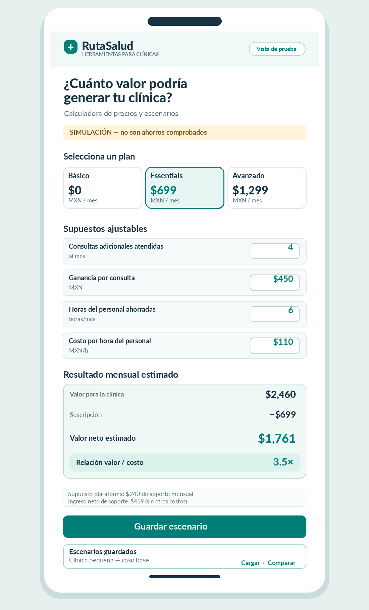
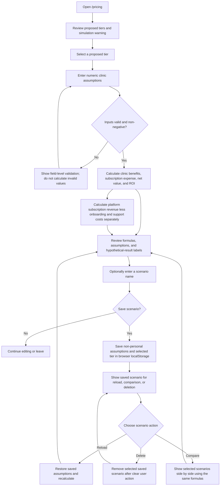
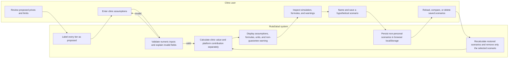

# RutaSalud — Week 14 Pricing Packet

**Objective:** Test proposed clinic subscription economics with a transparent, hypothetical calculator. This packet defines a plan; it does not claim that pricing, savings, or feature value has been validated.

## 1. Problem

RutaSalud needs pricing evidence before presenting subscriptions as a viable business model. Clinics need a clear way to compare a proposed fee with possible operational value, while RutaSalud needs to distinguish an attractive idea from evidence that a real customer will pay. A calculator can make assumptions and tradeoffs visible, but its projections are simulations—not proof of savings, demand, or return.

## 2. Exact user

A small-clinic owner or administrator in Mexico City evaluating whether RutaSalud's proposed booking and administrative tools could justify a monthly subscription.

## 3. Success definition

Before the Week 14 module closes, the live, mobile-friendly `/pricing` calculator works, calculates the displayed values correctly from validated inputs, and lets a user save, reload, compare, and delete named hypothetical scenarios that remain available after a page refresh.

## 4. Image-generated mockup

The supplied image is a design reference, not evidence that the calculator or any proposed benefit exists.

## 5. Calculator and scenario workflow

The clinic-value view compares hypothetical monthly clinic benefits with the selected subscription price. Keep RutaSalud's platform contribution calculation separate; do not present either result as a guaranteed return.

## 6. Clinic user / RutaSalud system swimlane

## 7. Global benchmark: Doctoralia Mexico

Doctoralia Mexico is an established discovery/booking benchmark for this product exercise. RutaSalud's intended differentiation is transparent pricing assumptions, matching transparency, and an honest economic simulator—not a claim of superior performance. Current competitor features and terms have not been independently verified and must be checked before making comparative claims.

## 8. Three-sentence long-term vision

In three years, if validated, RutaSalud could help Mexico City patients compare doctors using understandable, up-to-date information while keeping patient search and comparison free. It could give clinics practical booking and administrative tools with transparent subscription terms and evidence about the value they actually receive. Its growth would depend on measured patient trust, clinic operations, and real payer behavior—not simulated ROI or stated enthusiasm alone.

## 9. Scope cuts

- No payments, billing, or subscription enforcement.
- No real calendar integrations or confirmed appointment availability.
- No live AI.
- No automatic consultation-price verification.
- No clinical records or patient health data.
- No implementation or promise of proposed Clinic Advanced features; those features are unverified.
- Do not rebuild existing doctor search, comparison, or ranking.
- No new authentication or database for anonymous, non-personal calculator scenarios.

## 10. Architecture and stack

Reuse the existing RutaSalud project and deployment workflow. Build `/pricing` within the existing application; use browser `localStorage` for anonymous, non-personal scenarios. Do not add a service, credential, or infrastructure requirement for this calculator.

| Area | Existing/reused choice | Week 14 boundary |
|---|---|---|
| Application | Existing Next.js and React app | Add a pricing route; preserve the existing doctor-search experience. |
| Styling | Existing Tailwind CSS | Follow the application's current visual patterns and support small screens. |
| Scenario persistence | Browser `localStorage` | Store only named hypothetical assumptions and selected tier; no personal or patient data. |
| Backend/data | Existing Supabase infrastructure only if later needed | No new table, authentication, or backend is needed for anonymous local scenarios. |
| Source control | Existing GitHub repository | Work in the current repository; no new project. |
| Hosting | Existing Vercel deployment | Use the current deployment path; no separate deployment. |

### Proposed tiers and transparent formulas

All amounts below are **unvalidated monthly MXN pricing hypotheses**:

| Proposed tier | Monthly price | Proposed limit / status |
|---|---:|---|
| Basic | $0 | Basic profile and fair search inclusion. |
| Individual Essentials | $499 | Proposed individual subscription. |
| Small Clinic Essentials | $699 | Proposed subscription for up to 3 doctors. |
| Clinic Advanced | $1,299 | Proposed subscription for up to 5 doctors; advanced features are not verified or implemented. |

Use clearly named assumptions: additional attended consultations per month; contribution profit per additional attended consultation (not gross consultation price); staff hours saved per month; staff hourly cost; selected subscription price; estimated monthly clinic implementation/support expense; and RutaSalud onboarding and support costs per clinic per month.

Formulas to show beside the results:

- **Additional consultation contribution** = additional attended consultations × contribution profit per consultation.
- **Staff-time value** = staff hours saved × staff hourly cost.
- **Hypothetical clinic monthly benefits** = additional consultation contribution + staff-time value.
- **Clinic subscription expense** = selected proposed monthly tier price.
- **Hypothetical clinic net value** = hypothetical clinic monthly benefits − subscription expense − monthly clinic implementation/support expense.
- **Clinic ROI/value comparison** = (hypothetical clinic net value ÷ subscription expense) × 100. If subscription expense is $0, show ROI as “Not applicable” and show the benefit and expense amounts without division.
- **Clinic net ROI** = (hypothetical clinic net value ÷ (subscription expense + monthly clinic implementation/support expense)) × 100. If total clinic costs are $0, show ROI as “Not applicable.”
- **RutaSalud platform contribution per clinic** = subscription revenue − estimated monthly onboarding/support costs. Present this separately from clinic value and label it as a hypothetical monthly estimate, not real revenue.

## 11. Test plan

- **Calculations:** Check each formula with known inputs, zero values, fractional staff hours, and multiple tiers; verify rounding and currency display.
- **Edge cases:** Test zero-priced Basic, zero subscription expense, zero benefits, high but valid values, and no saved scenarios. Avoid division by zero and misleading ROI output.
- **Invalid inputs:** Reject or clearly validate negative, non-finite, malformed, and out-of-range values; require whole consultations where appropriate. Do not silently coerce invalid values into plausible results.
- **Persistence:** Save, refresh, reload, compare, and delete scenarios; verify names and assumptions persist locally and deleted items do not reappear.
- **Mobile usability:** Check narrow viewport layout, readable results, keyboard operation, labels, focus, and controls that remain usable without horizontal scrolling.
- **Transparency:** Verify proposed-tier labels, units, formulas, hypothetical/non-guarantee warnings, platform-versus-clinic separation, and source/date/status labels for any consultation prices shown elsewhere in the app.
- **Security and privacy:** Keep scenario data non-personal and browser-local; do not store patient or health information, credentials, or secrets. Treat local storage as user-controlled and untrusted input; handle malformed stored data safely and do not render scenario names as executable markup.

## 12. Blueprint conditions and shadow clause

Preserve these conditions in design, implementation, and any later evidence:

- Patient doctor search and comparison remain free.
- Payment never improves medical credibility, verification status, or patient-match ranking.
- A request is not a confirmed appointment without confirmation evidence.
- Any unverified consultation price has an appropriate status and, where applicable, its source and date.
- The calculator labels projections as simulations, not verified savings, guaranteed outcomes, or proof of demand.
- Record explicit evidence when a real payer accepts a specific price. Someone saying they like the app is not payer evidence.

**Shadow clause:** No simulated calculation, mockup, stated preference, or proposed tier may be presented as a real clinic outcome, verified saving, accepted price, booking, or approved Blueprint condition. If evidence is missing, label it as missing; do not imply certainty.

## 13. Evidence boundaries

| Category | What is known for this packet |
|---|---|
| Decisions | Reuse the current RutaSalud repository and stack; keep patient search free and ranking unbiased; use non-personal browser-local scenarios; separate clinic value from RutaSalud platform contribution. |
| Hypotheses | The four tier prices and limits; possible additional attended consultations; contribution profit; staff time saved; and whether proposed tools justify a clinic subscription. Calculator outputs are hypothetical. |
| Missing validation | Whether clinics will pay any specific tier price; whether the assumptions match clinic operations; actual incremental attended consultations, staff-time savings, onboarding/support costs, or realized clinic value; which Advanced features clinics need; current competitor features and terms; and live product performance. |

A clinic's actual payment or signed, price-specific commitment is distinct from positive feedback or intent. Record the price, payer, commitment type, and evidence before describing willingness to pay as validated.
