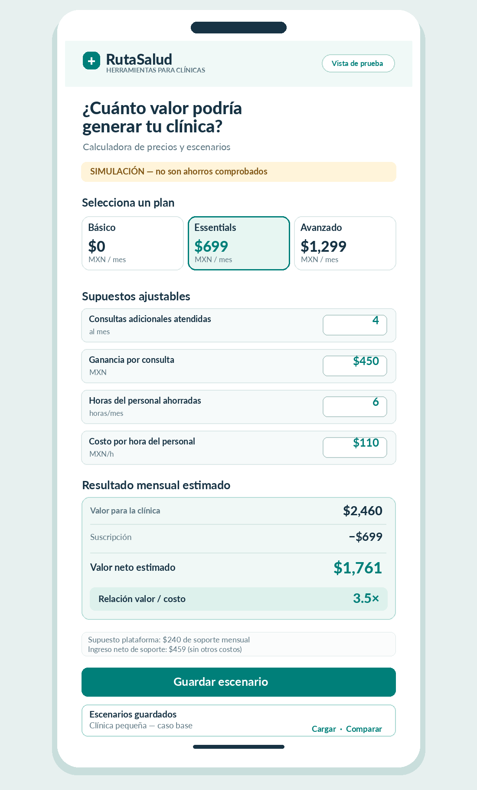
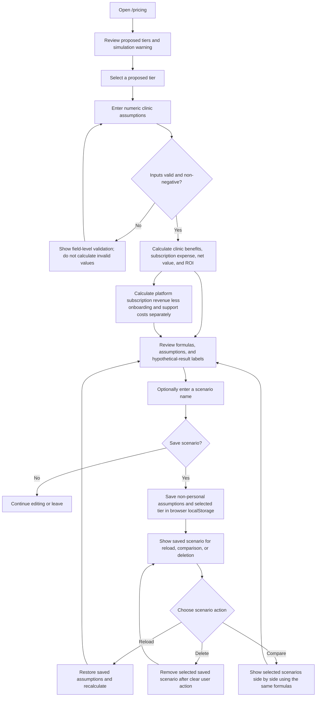
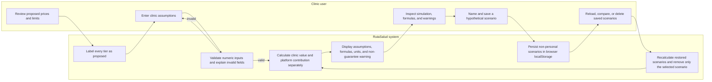
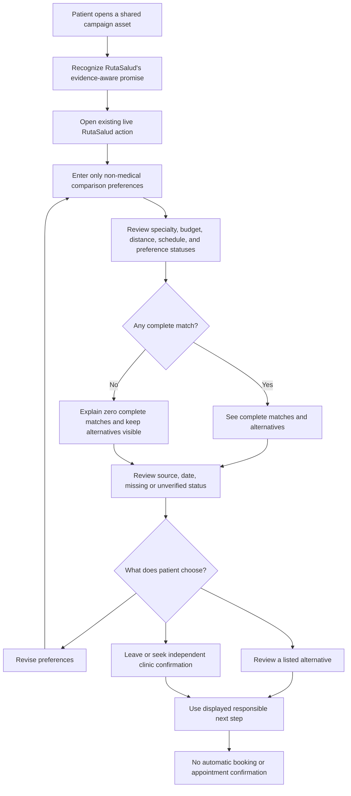
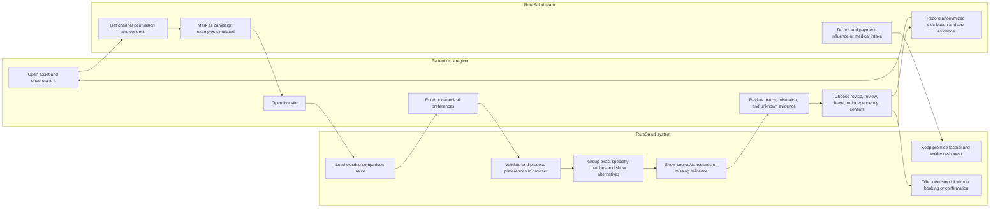

# RutaSalud — Week 14 Pricing Packet

**Objective:** Test proposed clinic subscription economics with a transparent, hypothetical calculator. This packet defines a plan; it does not claim that pricing, savings, or feature value has been validated.

## 1. Problem

RutaSalud needs pricing evidence before presenting subscriptions as a viable business model. Clinics need a clear way to compare a proposed fee with possible operational value, while RutaSalud needs to distinguish an attractive idea from evidence that a real customer will pay. A calculator can make assumptions and tradeoffs visible, but its projections are simulations—not proof of savings, demand, or return.

## 2. Exact user

A small-clinic owner or administrator in Mexico City evaluating whether RutaSalud's proposed booking and administrative tools could justify a monthly subscription.

## 3. Success definition

Before the Week 14 module closes, the live, mobile-friendly `/pricing` calculator works, calculates the displayed values correctly from validated inputs, and lets a user save, reload, compare, and delete named hypothetical scenarios that remain available after a page refresh.

## 4. Image-generated mockup

The supplied image is a design reference, not evidence that the calculator or any proposed benefit exists.

## 5. Calculator and scenario workflow

The clinic-value view compares hypothetical monthly clinic benefits with the selected subscription price. Keep RutaSalud's platform contribution calculation separate; do not present either result as a guaranteed return.

## 6. Clinic user / RutaSalud system swimlane

## 7. Global benchmark: Doctoralia Mexico

Doctoralia Mexico is an established discovery/booking benchmark for this product exercise. RutaSalud's intended differentiation is transparent pricing assumptions, matching transparency, and an honest economic simulator—not a claim of superior performance. Current competitor features and terms have not been independently verified and must be checked before making comparative claims.

## 8. Three-sentence long-term vision

In three years, if validated, RutaSalud could help Mexico City patients compare doctors using understandable, up-to-date information while keeping patient search and comparison free. It could give clinics practical booking and administrative tools with transparent subscription terms and evidence about the value they actually receive. Its growth would depend on measured patient trust, clinic operations, and real payer behavior—not simulated ROI or stated enthusiasm alone.

## 9. Scope cuts

- No payments, billing, or subscription enforcement.
- No real calendar integrations or confirmed appointment availability.
- No live AI.
- No automatic consultation-price verification.
- No clinical records or patient health data.
- No implementation or promise of proposed Clinic Advanced features; those features are unverified.
- Do not rebuild existing doctor search, comparison, or ranking.
- No new authentication or database for anonymous, non-personal calculator scenarios.

## 10. Architecture and stack

Reuse the existing RutaSalud project and deployment workflow. Build `/pricing` within the existing application; use browser `localStorage` for anonymous, non-personal scenarios. Do not add a service, credential, or infrastructure requirement for this calculator.

| Area | Existing/reused choice | Week 14 boundary |
|---|---|---|
| Application | Existing Next.js and React app | Add a pricing route; preserve the existing doctor-search experience. |
| Styling | Existing Tailwind CSS | Follow the application's current visual patterns and support small screens. |
| Scenario persistence | Browser `localStorage` | Store only named hypothetical assumptions and selected tier; no personal or patient data. |
| Backend/data | Existing Supabase infrastructure only if later needed | No new table, authentication, or backend is needed for anonymous local scenarios. |
| Source control | Existing GitHub repository | Work in the current repository; no new project. |
| Hosting | Existing Vercel deployment | Use the current deployment path; no separate deployment. |

### Proposed tiers and transparent formulas

All amounts below are **unvalidated monthly MXN pricing hypotheses**:

| Proposed tier | Monthly price | Proposed limit / status |
|---|---:|---|
| Basic | $0 | Basic profile and fair search inclusion. |
| Individual Essentials | $499 | Proposed individual subscription. |
| Small Clinic Essentials | $699 | Proposed subscription for up to 3 doctors. |
| Clinic Advanced | $1,299 | Proposed subscription for up to 5 doctors; advanced features are not verified or implemented. |

Use clearly named assumptions: additional attended consultations per month; contribution profit per additional attended consultation (not gross consultation price); staff hours saved per month; staff hourly cost; selected subscription price; estimated monthly clinic implementation/support expense; and RutaSalud onboarding and support costs per clinic per month.

Formulas to show beside the results:

- **Additional consultation contribution** = additional attended consultations × contribution profit per consultation.
- **Staff-time value** = staff hours saved × staff hourly cost.
- **Hypothetical clinic monthly benefits** = additional consultation contribution + staff-time value.
- **Clinic subscription expense** = selected proposed monthly tier price.
- **Hypothetical clinic net value** = hypothetical clinic monthly benefits − subscription expense − monthly clinic implementation/support expense.
- **Clinic ROI/value comparison** = (hypothetical clinic net value ÷ subscription expense) × 100. If subscription expense is $0, show ROI as “Not applicable” and show the benefit and expense amounts without division.
- **Clinic net ROI** = (hypothetical clinic net value ÷ (subscription expense + monthly clinic implementation/support expense)) × 100. If total clinic costs are $0, show ROI as “Not applicable.”
- **RutaSalud platform contribution per clinic** = subscription revenue − estimated monthly onboarding/support costs. Present this separately from clinic value and label it as a hypothetical monthly estimate, not real revenue.

## 11. Test plan

- **Calculations:** Check each formula with known inputs, zero values, fractional staff hours, and multiple tiers; verify rounding and currency display.
- **Edge cases:** Test zero-priced Basic, zero subscription expense, zero benefits, high but valid values, and no saved scenarios. Avoid division by zero and misleading ROI output.
- **Invalid inputs:** Reject or clearly validate negative, non-finite, malformed, and out-of-range values; require whole consultations where appropriate. Do not silently coerce invalid values into plausible results.
- **Persistence:** Save, refresh, reload, compare, and delete scenarios; verify names and assumptions persist locally and deleted items do not reappear.
- **Mobile usability:** Check narrow viewport layout, readable results, keyboard operation, labels, focus, and controls that remain usable without horizontal scrolling.
- **Transparency:** Verify proposed-tier labels, units, formulas, hypothetical/non-guarantee warnings, platform-versus-clinic separation, and source/date/status labels for any consultation prices shown elsewhere in the app.
- **Security and privacy:** Keep scenario data non-personal and browser-local; do not store patient or health information, credentials, or secrets. Treat local storage as user-controlled and untrusted input; handle malformed stored data safely and do not render scenario names as executable markup.

## 12. Blueprint conditions and shadow clause

Preserve these conditions in design, implementation, and any later evidence:

- Patient doctor search and comparison remain free.
- Payment never improves medical credibility, verification status, or patient-match ranking.
- A request is not a confirmed appointment without confirmation evidence.
- Any unverified consultation price has an appropriate status and, where applicable, its source and date.
- The calculator labels projections as simulations, not verified savings, guaranteed outcomes, or proof of demand.
- Record explicit evidence when a real payer accepts a specific price. Someone saying they like the app is not payer evidence.

**Shadow clause:** No simulated calculation, mockup, stated preference, or proposed tier may be presented as a real clinic outcome, verified saving, accepted price, booking, or approved Blueprint condition. If evidence is missing, label it as missing; do not imply certainty.

## 13. Evidence boundaries

| Category | What is known for this packet |
|---|---|
| Decisions | Reuse the current RutaSalud repository and stack; keep patient search free and ranking unbiased; use non-personal browser-local scenarios; separate clinic value from RutaSalud platform contribution. |
| Hypotheses | The four tier prices and limits; possible additional attended consultations; contribution profit; staff time saved; and whether proposed tools justify a clinic subscription. Calculator outputs are hypothetical. |
| Missing validation | Whether clinics will pay any specific tier price; whether the assumptions match clinic operations; actual incremental attended consultations, staff-time savings, onboarding/support costs, or realized clinic value; which Advanced features clinics need; current competitor features and terms; and live product performance. |

A clinic's actual payment or signed, price-specific commitment is distinct from positive feedback or intent. Record the price, payer, commitment type, and evidence before describing willingness to pay as validated.

---

# RutaSalud — Week 15 Distribution & Launch Packet

**Objective:** Prepare a focused, evidence-honest distribution and launch package for the existing RutaSalud experience. This packet plans distribution and future implementation; it does not claim that doctors, prices, availability, bookings, demand, or clinic willingness to pay have been verified.

## 1. Strategy

### Exact audience and need

The primary audience is an adult patient or caregiver in Mexico City who is actively trying to choose among doctors for a defined general need and needs to compare specialty, budget, distance, schedule, and stated preferences. The immediate need is to understand which simulated or available profiles match, which alternatives remain uncertain, what consultation information is shown, and what responsible next step is possible. They may not need a diagnosis, emergency care, or an appointment conclusion from RutaSalud.

Patients should not enter medical details. This audience is reached in Spanish (Mexico), on mobile, and with the existing free search/comparison experience.

### Positioning statement

> **RutaSalud helps you find doctors who fit your needs, compare consultation information, and see what has—and has not—been verified before deciding what to do next.**

### Supporting evidence from prior user tests

The prior evidence is limited and mostly user-reported:

- Six real people provided feedback on the search and comparison experience. The project owner supplied the roles and stranger count, but no dates, consent records, moderated task scripts, completion rates, or timing were supplied.
- Participants reported confusion about why nonmatching doctors remained visible and what to do after no complete match.
- One participant reported uncertainty about the actual booking next step.
- A separate returned participant reported that the specialty was too broad and asked to sort or narrow by specialization.
- The comparison and specialty fixes were implemented and mechanically/live-deployment checked, but no identified participant has been reported as retesting either fix.
- Therefore, the evidence supports specific **hypotheses** to test, not a claim that clarity, confidence, specialty filtering, or booking understanding improved.
- Five anonymous audience responses were later supplied: all five described RutaSalud's basic value proposition and stated a hypothetical willingness to click, subject to their stated conditions. Verification/trust, simpler comparison visuals, stronger contrast, and booking clarity appeared in the feedback. The collection context does not establish actual website or campaign-asset exposure, clicks, task completion, or verified provider data; details are recorded in [docs/WEEK15_DISTRIBUTION_TEST.md](./WEEK15_DISTRIBUTION_TEST.md).
- A separate five-person task-results report records all five as self-reporting task completion and simulation awareness, with approximate durations, confusion, and intended next actions. Two reported information overload and one reported booking confusion; two reported no significant confusion. These are participant reports, not independently observed task completion or measured time. See [docs/WEEK15_DISTRIBUTION_TEST.md](./WEEK15_DISTRIBUTION_TEST.md).

### Promise we will not make

RutaSalud will not promise to find the “best doctor,” a verified match, confirmed consultation availability, or a confirmed appointment. All decisions remain the patient's; payment by a clinic will never change rank or verification status.

## 2. Brand

### Three brand voice rules

1. **Clear, not clinical.** Explain match status and next steps in direct Mexican Spanish with short sentences.
2. **Honest about evidence.** Name verified, unverified, missing, simulated, and outdated information. Never turn uncertainty into certainty.
3. **Calm and patient-led.** Use neutral language, preserve alternatives, and never pressure a patient to choose or share medical information.

### Weak marketing line rewritten

- **Weak:** “Encuentra al doctor perfecto para ti.”
- **RutaSalud:** “Compara opciones según tus preferencias y entiende qué información está confirmada, pendiente o no disponible.”

The rewrite avoids a subjective “perfect” claim and makes evidence and patient control explicit.

### Color palette and typography hierarchy

| Role | Existing direction / value | Use |
|---|---|---|
| Deep trust green | `#14532d` or the closest existing accessible green | Primary headings and confirmed match labels; retain accessible contrast |
| Clear blue | `#1d4ed8` or the closest existing accessible blue | Links, primary actions, and informational states |
| Warm neutral | `#f8faf8` | Page and card backgrounds |
| Ink | `#17211b` | Main text |
| Caution amber | `#92400e` on a pale amber field | Unknown, missing, or outdated evidence |
| Alert/mismatch | `#991b1b` on a pale red field | Mismatches or unavailable states |

Use Tailwind's existing accessible text sizes and patterns. Typography hierarchy:

1. Page heading: high-contrast, 28–32 px equivalent on mobile.
2. Section heading: 20–24 px.
3. Card title and key status: 16–18 px, semibold.
4. Body and explanations: 15–16 px.
5. Evidence labels and source/date text: 13–14 px, high contrast.

### Repeatable visual layout

Use a mobile-first vertical card:

1. A plain-language question or scenario.
2. The patient's chosen criteria or input.
3. RutaSalud's status explanation.
4. A clear evidence label and source/date when available.
5. One primary next action and one low-pressure alternative.
6. A short disclaimer that this is a comparison aid, not medical guidance or booking confirmation.

In campaign assets, keep one main visual, 5–7 lines of copy, and one QR or link. Reuse the same status badge and footer language across formats.

### Fit with patients in Mexico City

The voice is direct, pragmatic, and mobile-first for people comparing constraints around specialty, budget, distance, and schedule in daily life. Green, blue, neutral surfaces, and explicit text states support fast scanning while the evidence disclaimer prevents an established clinic brand or a high score from implying verification. It fits an independent patient or caregiver decision, not an emergency or treatment recommendation.

## 3. Creative Range

### Three recurring content series

1. **“Qué significa la coincidencia”** — explains complete matches, alternatives, mismatches, and unknown data.
2. **“Qué está confirmado”** — distinguishes consultation information with a source/date from missing or outdated information.
3. **“Después, tú decides”** — shows useful, non-booking next steps when a patient has alternatives or no complete match.

### Six content concepts

**Qué significa la coincidencia**
1. **Purposely finished concept:** “Completa no significa perfecta.” A card explains that every stated preference matched, while RutaSalud does not verify clinical suitability.
2. **Purposeful sketch/headline:** “Sin coincidencias completas: no estás obligado a elegir.”

**Qué está confirmado**
3. **Purposely finished concept:** “Tres etiquetas: confirmado, pendiente y no disponible.” A visual compares an evidenced price, an old or missing source, and a missing value.
4. **Purposeful sketch/headline:** “Una consulta visible: ¿qué tiene detrás?”

**Después, tú decides**
5. **Purposely finished concept:** “Encontraste una opción alternativa. Aquí tienes qué revisar primero.” A checklist of specialty, budget, distance, schedule, evidence status, and what to ask or verify.
6. **Purposeful sketch/headline:** “Tu siguiente paso no tiene que ser reservar.”

The three finished concepts 1, 3, and 5 are the planned campaign assets. Concepts 2, 4, and 6 remain sketches/headlines and are not represented as measured findings or final copy.

### Finished campaign asset plan

| Asset | Series | Format | Contents |
|---|---|---|---|
| A: complete-match card | Qué significa la coincidencia | 1080 × 1080 social graphic | Count of complete matches, an alternative label explanation, and link to `/launch` |
| B: evidence-status carousel | Qué está confirmado | 4-slide Instagram/WhatsApp-ready carousel | Source/date/missing status examples, all explicitly simulated for launch testing, and link to `/launch` |
| C: next-step checklist | Después, tú decides | Mobile vertical 1080 × 1920 graphic | Review fields, do not infer confirmation, and a visible `/launch` link |

All price and provider examples used in campaign assets must be fictional/simulated, marked as such, and must not resemble a real clinic claim. The three assets use at least two formats: square graphic, carousel, and vertical graphic.

### Real input → method → useful output

**Real input:** “I need to compare cardiology options with a $1,000 MXN budget, within 5 km, in the afternoon.”

**RutaSalud's method:** The existing comparison workflow checks each provider's listed specialty against the selected specialty exactly and checks budget, distance, schedule, and stated preference, while keeping missing or unverified values unknown rather than a match.

**Useful output:** “0 coincidencias completas. 4 alternativas visibles: 2 do not match budget, 1 does not match distance, 1 has an unknown schedule; the listed specialty must be reviewed. Consulta directly with the clinic before assuming availability or price.”

This example is an illustrative use of the fictional app method, not observed user behavior or a verified provider search.

## 4. Distribution

### Distribution plan

Place two finished pieces in front of the intended audience through privacy-conscious public channels:

1. **Asset A — medical-neighbor or patient-oriented WhatsApp/status share**, in relevant consenting community or neighborhood groups where administrators permit health-resource posts. Request permission from group moderators rather than unsolicited bulk messaging.
2. **Asset B — Instagram or Facebook post**, with a link to the existing RutaSalud website, only in accounts/groups that are appropriate for local consumer health discovery and allow public health information.

The first-person outreach is explicit and consent-based:

> “Hola. RutaSalud es una herramienta gratuita para comparar opciones ficticias/simuladas y revisar qué información está confirmada, no disponible o pendiente. Puede abrirla aquí: [link]. No enviamos ni guardamos datos médicos. ¿Autoriza que le compartamos el enlace para que lo revise y nos diga si encuentra claras las coincidencias y el siguiente paso?”

No clinic or patient data is collected in this pilot. If contact information is later collected, explain who collects it, the purpose, the retention period, how to withdraw, and the relevant Mexican data notice; collect no health details. A checkbox or equivalent explicit opt-in should be separate from search use and from clinic payment. Until implementation exists, outreach will not imply a signup or await consent.

### Working next action on the existing website

The distribution links must land on an existing working RutaSalud action:

- `/` for a public comparison search.
- `/comparison` or the existing comparison result route as it is available in the repository, for the corresponding next step.
- The action is to review or revise fictional preferences and inspect match/alternative evidence, not to submit medical details or confirm an appointment.

Use the existing live URL as the canonical destination and avoid separate landing pages or app deployments. Campaign assets must not link to unavailable routes.

### Distribution test evidence

Distribution was actually tested only if records from the real run show:

- The exact asset, channel, URL, date, and moderator/account approval or consent context.
- The link opened successfully on a mobile device and reached the stated comparison action.
- At least the intended sample size agreed in advance (for the first test, **5 consented, anonymized participants**), completed the assigned task with no collection of medical information.
- Each participant's task success, elapsed time, confusion point, and whether they understood the evidence status and next step are recorded separately.
- Aggregate counts, not names or sensitive data, are recorded. No engagement count is invented.

Evidence of distribution must not be written as evidence of bookings, verified provider quality, retention, conversion, clinic demand, or adoption.

## 5. Product Charter

### Exact Week 15 success definition

Week 15 succeeds only if, before the campaign package closes, two planned pieces are placed in permitted channels in front of the intended audience, at least five consented participants are exposed to the website and can complete a documented basic match/evidence/next-step task, and the record separately reports task completion, time, confusion, and evidence/next-step understanding. No success claim is allowed if the evidence is missing or the route is not working on mobile.

### Scope exclusions

- No live doctor data, verified prices, verified credentials, or appointment availability.
- No confirmed or real appointment, booking, payment, or clinic request.
- No clinic ranking changes or verification benefits for a payer.
- No emergency workflow or medical advice.
- No sensitive medical information, diagnosis, or clinical record collection.
- No payments, CRM, analytics that identify users, ad platform account, database, API, secret, or third-party tracking integration.
- No new project, repository, API key, or deployment target.
- No waitlist/contact collection, paid advertising account, or campaign assets beyond the three planned Week 15 pieces.

### Architecture and stack

Reuse the existing Next.js/React/Tailwind application, browser-only state, Supabase read-only public data if already configured, existing GitHub repository, and GitHub-triggered Vercel deployment. Week 15 distribution adds no required service. If opt-in contact storage is approved later, use the least-privilege existing stack and document a real retention/deletion mechanism; do not collect medical information.

| Area | Existing/reused choice | Week 15 boundary |
|---|---|---|
| Application | Existing Next.js and React app | Public `/launch` page; primary CTA links to the existing `/#preferences-title` comparison form |
| Styling | Existing Tailwind CSS | Mobile-first, accessible evidence labels, no new design system |
| Data | Existing fictional/unverified provider patterns and optional read-only Supabase | No live verification claims or patient storage |
| Analytics | None; use optional aggregate link parameters or test counts only if approved | No cross-site identifiers, sensitive fields, or invented performance |
| Distribution | WhatsApp, Instagram/Facebook, existing permissive groups, canonical live URL | Public or moderator-approved, no unsolicited bulk messages |
| Source control | Existing GitHub repository | No new repository or branch as a separate project |
| Hosting | Existing Vercel deployment | No separate campaign deployment |

### Three-year vision

Over three years, RutaSalud could become a trusted Mexico City comparison tool by publishing reproducible evidence standards, traceable consultation information, clear patient-controlled next steps, and measurable usability improvements. It could also offer clinics transparent, optional software products only if independent research establishes willingness and ability to pay. Growth would remain conditional on real patient usage, reliable providers, and patient trust; clinic subscription fees would never influence rank or verification.

### Relevant benchmark

Doctoralia Mexico remains the relevant global benchmark for discovery and appointment-oriented UX. It is a competitor reference, not evidence that RutaSalud has comparable coverage or superior outcomes. Any future feature claim or comparison must come from a dated, traceable review and must not imply verification.

### Mermaid user flow

### Responsibility swimlane

### Test plan

- **Content accuracy:** Every claim is traceable to this packet or existing evidence. No implied verified doctor, price, appointment, booking, performance, testimonial, conversion, engagement, or partnership.
- **Channel suitability:** Confirm moderator or platform approval, prohibited-advertising constraints, and a mobile-readable public destination before placement.
- **Next action:** Open each distributed link on iOS/Android-class mobile viewports; confirm HTTP success and the existing working route; verify no medical input field appears.
- **Match flow:** Exercise complete, alternative, zero-complete, missing evidence, different specialty, and no-preference states with synthetic values. Confirm exact matching and patient-controlled next steps.
- **Transparency:** Inspect every provider/price/appointment label for simulated, unverified, missing, or outdated language. Reject any launch asset that implies real availability or confirmation.
- **Consent/privacy:** Verify no unsolicited bulk outreach, no health fields, no hidden contact collection, and no cross-session identity collection.
- **Usability:** At 390 px and a second common mobile width, verify no horizontal overflow, readable text, keyboard operation, focus behavior, and one clear primary action.
- **Evidence capture:** Record asset/channel/date/approval, route result, aggregate task counts, time/confusion/understanding, and limitations. Do not retrospectively create engagement or participant records.

### Implementation acceptance criteria

Application implementation in a later Week 15 step is accepted only if:

1. The existing live route and every distributed next action works without a separate deployment or API key.
2. It stays mobile-responsive and accessible and never includes a medical-information field.
3. Complete-match, alternative, unknown, zero-match, and specialty states remain consistent with existing deterministic logic.
4. Simulated providers/prices/availability remain visibly simulated and can never be labeled confirmed.
5. No clinic payment affects rank, evidence status, provider visibility, or verification.
6. No wording claims “best,” confirmed availability, confirmed appointment, real user improvement, or validated willingness to pay.
7. Any future opt-in contact field is explicit, purpose-specific, separately consented, and has a real notice, retention, and withdrawal path.
8. Automated tests, lint, build, mobile smoke checks, and an actual distribution record pass before the campaign is described as tested.

### Implementation status

- The existing application now serves the public launch page at `/launch`. Its primary action links to the existing comparison workflow; no separate project or deployment was created.
- The three planned finished pieces are available as files under `public/campaign/week15/`: one square comparison graphic, four evidence-status carousel slides, and one vertical next-step graphic. Their copy and examples remain explicitly fictional/simulated.
- The three other content concepts above remain purposeful sketches/headlines.
- The page includes a generated PNG Open Graph image for sharing. No waitlist or contact form is present.
- The existing Vercel URL serves `/launch`, its PNG share preview, and all campaign graphics after the Week 15 push.
- Automated and local browser checks are recorded in [docs/WEEK15_TEST_LOG.md](./WEEK15_TEST_LOG.md). These are implementation checks, not evidence that the assets have reached an audience.
- **Qualitative responses:** Five anonymous audience-response summaries and five self-reported task results are recorded in [docs/WEEK15_DISTRIBUTION_TEST.md](./WEEK15_DISTRIBUTION_TEST.md). The task reports do not establish independently observed behavior, measured time, verified clicks, conversions, or provider information.
- **Distribution remains incomplete:** the evidence supplied does not establish two distinct finished pieces placed in permitted channels or participant consent and independently established website exposure. Preserve the task data as self-report; do not claim the reviewed screenshot proves delivery of two separate graphics or claim Week 15 distribution success.
