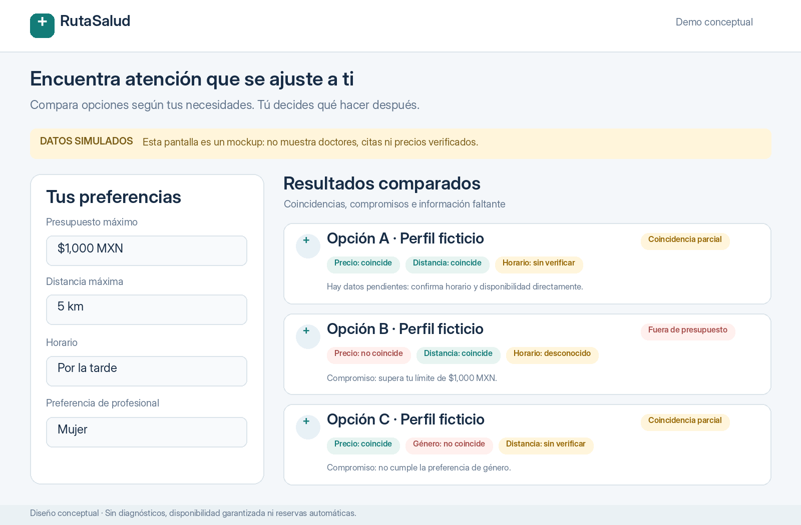
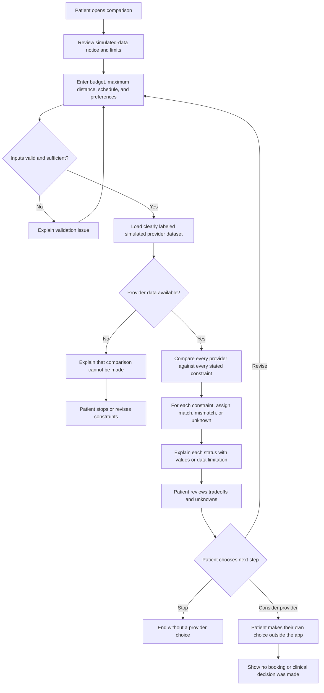
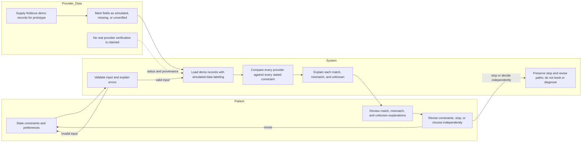

# Detection-to-Treatment Navigation

**Owner:** Inés Escoto  
**Origin:** Week 5 healthcare-navigation project  
**Status:** Venture packet; application not yet implemented

## Product charter

Build a patient-controlled doctor comparison application. Patients enter a budget, maximum distance, schedule, and provider preferences. The application compares doctors against those stated constraints and explicitly explains every match, mismatch, and unknown before the patient chooses.

## Problem

Patients struggle to find suitable doctors because price, location, schedules, and personal preferences are difficult to compare across providers.

## Exact user

A patient in Mexico City seeking medical follow-up or a replacement for an unsuitable doctor, with financial, geographic, scheduling, or provider-preference constraints.

## Success definition

Before the module closes, the live application must accept patient constraints and display transparent comparisons using clearly labeled simulated provider data. This is a delivery target, not evidence that the product has achieved a real-world outcome or validated demand.

## Evidence status and demand validation

No patient interview, affected-person account, or provider-data verification is documented in this packet. Do not claim validated demand until a real affected person has been documented with their permission and the evidence has been recorded.

| Evidence category | Current status |
|---|---|
| Observed | The project originated as a Week 5 healthcare-navigation project. No user observation is documented here. |
| Inferred | Price, location, schedules, and preferences may be difficult for the exact user to compare across providers; this is the problem hypothesis to test. |
| Missing | A documented account from a real affected person; evidence of how that person currently completes the full doctor-search task; and verified provider facts suitable for real-world comparison. |
| Unverified | Demand, usability, comparison accuracy with real provider data, and any claimed advantage over existing alternatives. |

Keep simulated demo results clearly labeled as simulated at every presentation point. Neither a prototype nor an intermediate test constitutes verified real-world success.

## Core feature: Step 4 — constraint-by-constraint comparison

The core engine is Step 4 of the project method: compare **every doctor** in the selected provider dataset against the patient's stated constraints. For each doctor and each constraint, show one of:

- **Match:** available data supports that the provider satisfies the constraint.
- **Mismatch:** available data indicates that the provider does not satisfy the constraint.
- **Unknown:** data is missing, unverified, or insufficient to decide.

Show the reason and the relevant value or data limitation for each status. Do not convert an unknown into a match, silently discard mismatches, or hide tradeoffs in an overall score. The comparison informs the patient; it does not select a doctor or make a clinical recommendation.

### Acceptance criteria

1. The patient can enter a budget, maximum distance, schedule, and provider preferences before comparison.
2. The system validates entries and explains invalid or incomplete inputs without silently substituting values.
3. Every provider in the selected dataset appears in the results, including providers with missing fields.
4. Every provider is compared against every patient-stated constraint, with a clearly labeled match, mismatch, or unknown for each.
5. Each result includes a concise explanation showing the compared values or why the result is unknown.
6. Demo provider records and the comparison view are conspicuously labeled **simulated data — not verified provider information**.
7. The patient retains control: they can review comparisons, revise constraints, stop, or choose what to do next. The system does not book, pay, diagnose, or choose on their behalf.
8. If no provider data is available or the data cannot support a comparison, the system says so and offers a stop/revise path rather than inventing results.

## Interface mockup — review before coding

Review the mockup against the acceptance criteria before implementation begins. The interface should visibly distinguish simulated information from verified facts and preserve patient choice. Do not portray invented providers, prices, distances, schedules, or availability as real.

## Complete feature flow

## Responsibilities and data swimlane

## Benchmark candidate: Doctoralia

Doctoralia is a candidate existing alternative to investigate for the same end-to-end task: find and compare a suitable doctor in Mexico City using budget, distance, schedule, and provider preferences, then decide what to do next. This packet does not establish which Doctoralia features or data are currently available in the relevant market, or whether the proposed product performs better.

The proposed differentiation is **transparent compromises and unknowns**, not a superiority claim: show every candidate against the patient's own constraints and explain each match, mismatch, and unknown, including missing or unverified information. Evaluate this with a complete-task comparison: recruit an appropriately consented real affected person, define the same search task and constraints for both experiences, record task completion, time, errors, comprehension of tradeoffs, and user-reported confidence, and document where information comes from. Do not claim improvement until this comparison has been run and its evidence supports the claim.

## Three-year vision

In three years, Detection-to-Treatment Navigation could help patients turn their own constraints into understandable comparisons across trustworthy, appropriately sourced care options. If user research and data partnerships support it, the product could make missing information and tradeoffs easier to resolve without taking control away from the patient. Any expansion would depend on demonstrated patient value, reliable data provenance, privacy safeguards, and explicit human choice rather than assumed growth or an untested improvement claim.

## Scope exclusions and human safeguards

- No diagnosis, triage, or treatment recommendation.
- No automatic booking or representation that a booking has been made.
- No payments or payment handling.
- No invented availability, provider facts, prices, distances, or schedules.
- No unrelated features.
- No hidden ranking that overrides the patient's stated constraints or obscures a mismatch or unknown.
- The patient may stop or revise constraints at any time. If data is insufficient, disclose that limitation and stop the comparison rather than fabricate an answer.
- Escalate unresolved data questions to an appropriate human or authoritative source; do not imply that the application has verified them.

## Architecture and responsibilities

| Component | Proposed choice | Responsibility / boundary |
|---|---|---|
| Web framework | Next.js | Application structure and routing. |
| UI library | React | Patient-facing constraint entry and comparison interface. |
| Styling | Tailwind CSS | Responsive, accessible presentation of inputs, labels, and explanations. |
| Data platform | Supabase | Any approved persistence and data access; enforce Row Level Security (RLS) on applicable tables. |
| Deployment | Vercel | Host the live application and deployment previews. |
| Source control | GitHub | Version history, review, and project collaboration. |
| Domain | A real, venture-owned domain — **not yet selected or verified** | Choose and verify ownership before publishing a production address; do not invent or imply a domain exists. |

### External dependencies and ownership

The owner, Inés Escoto, is responsible for documenting affected-person evidence, maintaining evidence labels, defining acceptance checks, reviewing simulated data, and deciding whether claims are supported. Dependencies include access to an image-generation tool for the pre-coding mockup, hosting and source-control accounts, a venture-owned domain if one is selected, and (for any future real-data use) suitable provider-data sources, permissions, provenance, and verification. None of those external arrangements is asserted as already complete.

## Security and privacy requirements

- Validate and constrain all patient inputs on the server boundary as well as in the interface; reject malformed values explicitly.
- Do not put secrets, service-role keys, or credentials in source code or client bundles. Use deployment-managed environment secrets.
- Use fictitious demo provider records only; do not use real patient information or imply demo-provider verification.
- Enable and test Supabase Row Level Security for tables exposed to the application. Grant only the access needed for each role; never rely on client-side checks as authorization.
- If personal data is stored, authentication is required. Minimize retained data, document its purpose and retention, and restrict access. If that cannot be implemented safely, do not persist personal data.
- Do not collect sensitive health details that are not necessary for the comparison task.

## Testing, feedback, and redeployment plan

1. **Mechanical testing:** verify input validation, boundary cases, full provider-by-constraint coverage, correct match/mismatch/unknown classification, explanation content, simulated-data labels, stop/revise paths, and responsive rendering. Test RLS and authorization if persistence is present.
2. **Persona testing:** use the exact-user scenario as a test persona, then test with a real affected person only with informed consent. Record what the participant actually did and said; distinguish observed behavior from interpretation. Do not describe a hypothetical persona exercise as user research.
3. **Bug fixing:** log reproducible defects, prioritize safety, misleading labels, omitted providers, incorrect status/explanation, and accessibility issues first; fix and rerun the affected tests before release.
4. **Redeployment:** deploy a preview for review, confirm the build and smoke-test the live preview, then deploy the accepted version. Verify the deployed URL and key flows after each deployment. If a release misrepresents simulated or unverified information, stop sharing it, correct the issue, and redeploy.
5. **Evidence review:** after testing, report what was tested, by whom or with what fixture, what remains unverified, and any limitations. Simulated or intermediate results must never be presented as verified real-world success.

## Implementation plan

Commit and deployment counts below are a planned minimum; they are not claims that work has already been completed. Keep each commit reviewable and run relevant checks before merging or deploying.

| Sequence | Planned commit / milestone | Verification or outcome |
|---|---|---|
| 1 | `docs: add venture packet and evidence boundaries` | Review this packet, acceptance criteria, scope, and mockup requirement before coding. |
| 2 | `feat: add patient constraint entry` | Validate budget, maximum distance, schedule, and preferences; test valid and invalid inputs. |
| 3 | `feat: add labeled simulated provider fixtures` | Use fictitious records and verify that simulated-data labeling is prominent. |
| 4 | `feat: compare providers against every constraint` | Test every provider/constraint pair and match, mismatch, and unknown explanations. |
| 5 | `feat: add transparent comparison and patient controls` | Test revise, stop, and independent-choice paths; verify no hidden selection or booking. |
| 6 | `test: cover comparison, security, and accessibility` | Run mechanical tests, persona review, RLS checks if persistence exists, and fix findings. |
| 7 | `docs: record release checks and evidence status` | Document tested behavior, known limits, data status, and deployment verification. |

**Deployment 1 — preview:** after the core comparison flow is implemented, deploy a preview and verify input, comparisons, labels, stop/revise behavior, and mobile/keyboard access. Fix defects and redeploy the preview as needed.

**Deployment 2 — live application:** after acceptance checks pass, deploy the live application and smoke-test the same critical paths at the deployed address. Confirm it uses only clearly labeled simulated data and does not imply real provider verification or real-world success. Any later deployment must repeat these checks.
