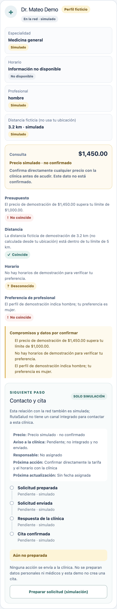
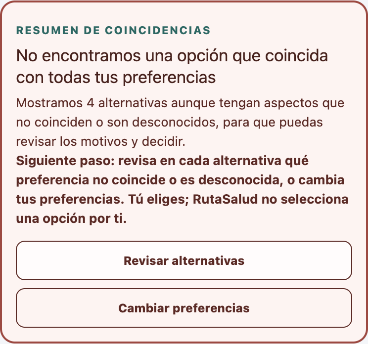

# Week 13 real-user testing

## Evidence boundary

The participant count, stranger count, roles, and feedback below were supplied by the project owner as participant-reported information. They are not independently verified session records. No interview dates, task scripts, observation notes, measurements, repeat visits, or clinical outcomes were supplied. Quotes are reproduced as provided; do not infer further behavior from them.

## 1. User-reported testing activity

Six real people provided feedback on RutaSalud. Three are explicitly identified as strangers to the project team. Their roles are used here instead of personal names:

| Participant | Role / relationship | User-reported feedback |
|---|---|---|
| Stranger 1 | Stranger to project team | “It was a little confusing seeing doctors that didn't match all my filters, like I wasn't sure why they were still showing up.” Requested last-updated dates for prices. Said they would use the app if the information were real and verified. |
| Stranger 2 | Stranger to project team | “I didn't really know what to do when none of the doctors matched everything I wanted.” Requested clearer visual distinctions between matches and mismatches. Said they would use the app if information were real and verified. |
| Stranger 3 | Stranger to project team | “I wasn't completely sure how to actually book an appointment after finding a doctor I liked.” Requested visible appointment times and direct booking. Said they would use the app if real and verified, particularly because they work full-time. |
| Global Business student, 21 | Role reported by project owner; stranger status not supplied | “Most of the page was pretty clear but I couldn't understand how bookings worked because there were a lot of options for doctors” Requested darker option colors for visibility. |
| Law student, 21 | Role reported by project owner; stranger status not supplied | “Nothing at all, everything was clear.” Requested access to doctor credentials and professional background information. |
| Law firm partner, 62 | Role reported by project owner; stranger status not supplied | “Pasar de paso 1 a paso 2” Requested more options or better search narrowing. |

The three conditional statements about using RutaSalud are reported intent, not evidence of adoption, retention, completed care, or willingness to use a real booking flow.

## 2. Three prioritized pain points and improvement hypothesis

The ranking reflects the reported threat to the search-to-decision workflow, not measured severity or frequency. The requested “10:1 improvement” is treated as an **unvalidated aspiration** to reduce workflow friction by an order of magnitude through a shared interface fix. There is no baseline, operational definition, timed measure, or observed 10x/10:1 outcome in the supplied evidence.

| Rank | Reported pain point | Workflow risk | Proposed response |
|---|---|---|---|
| 1 | Patients cannot tell why nonmatching doctors remain visible or what to do when no doctor matches all filters. Reported by Stranger 1 and Stranger 2; related “many options” feedback came from the Global Business student. | A patient may mistake an alternative for a full match, abandon the search, or be unable to choose a next step. This directly blocks comparison-to-decision. | State the number of complete matches, clearly mark each complete match versus alternative, explain that alternatives stay visible for patient choice, enumerate every unmet or unknown preference, and offer review/revise choices without selecting a doctor. |
| 2 | The next step after finding a preferred doctor is unclear, especially how booking works. Reported by Stranger 3 and the Global Business student. | The patient may stop after comparison or confuse a demo workflow with a real booking. | Make the available next step explicit, but retain the existing no-integration boundary: this demo can only explain or simulate states and cannot directly book. |
| 3 | Information is harder to assess or filter: requests included darker visual distinctions, price last-updated dates, credentials/background, visible appointment times, and more options/search narrowing. | Weak visual distinction or missing provenance/details may reduce confidence and make tradeoffs harder to scan. | Preserve explicit status colors/text, show source/date only when evidence exists, keep unknowns visible, and defer actual times, credentials, added options, and expanded search until reliable data is available. |

These are design priorities based on the supplied reports; they are not claims that a given issue occurred during a directly observed task. No counts beyond the stated six participants or three strangers are inferred.

## 3. Implemented response and before/after evidence

The #1 comparison-clarity improvement is implemented in the interface:

- Fully matching records receive a distinct, high-contrast “Coincidencia completa” label, counted only when every stated constraint is a match. Unknown information does not count as a match.
- Other records are labeled “Alternativa” and list the exact constraints that do not match or remain unknown.
- A prominent summary says when there are zero complete matches, explains why alternatives remain visible, and invites the patient to review alternatives or revise preferences.
- The patient still decides; RutaSalud does not rank or automatically select a provider.

Before/after screenshots use the same synthetic demo comparison scenario. They document the interface change only, not a participant retest or improved real-user performance.

### Before

### After

## 4. Documented observations and evidence

- The six role-based feedback reports and three-stranger count above were supplied by the project owner.
- The repository now includes before/after interface screenshots and automated regression tests for complete-match and alternative-summary behavior.
- [docs/PERSONA_TEST.md](./PERSONA_TEST.md) is a separate **synthetic persona exercise**, not a real-user session. It is not evidence from any of the six people.
- Automated tests and browser checks in [docs/TEST_LOG.md](./TEST_LOG.md) demonstrate software behavior, not participant behavior.
- No evidence of clinic response, real request delivery, or successful appointment was supplied. No successful appointment is claimed.

## 5. Missing evidence

The following items were not supplied and remain unavailable:

- Dates or testing period for each participant.
- Anonymous session IDs and per-session evidence of stranger status beyond the three supplied labels.
- Consent status or records.
- Tasks/scenarios, task completion, elapsed time, confusion, errors, or directly observed behavior.
- Device, viewport, moderator assistance, or test conditions for the participant sessions.
- Whether any request reached a real clinic or any appointment was confirmed.
- Any participant retest after the interface change.
- A baseline or outcome measure for the 10:1 improvement hypothesis.

Do not reconstruct missing notes, dates, measurements, or quotes from memory. Record new evidence only when collected; avoid names, contact details, and medical information.

## 6. Outstanding improvements

1. If further testing is conducted, capture consented, anonymized per-session tasks and observed completion/time/confusion/errors; distinguish direct observation from participant report and interpretation.
2. Retest the comparison-clarity change with users before making any claim that confusion, task completion, time, retention, or decisions improved.
3. Measure the hypothesized improvement against a defined baseline and task; the “10:1” idea has not been operationalized or validated.
4. Consider contrast improvements while preserving accessible contrast and text labels.
5. Add real price update dates only when supported by a traceable source; currently simulated price dates must not appear as clinic-confirmed.
6. Do not add visible real appointment times, credentials, or booking unless reliable source data and appropriate permissions exist. The current workflow remains simulated and does not book.
